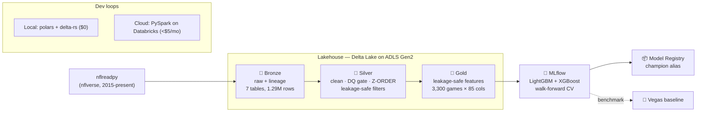

# 🏈 NFL Prediction Platform

**Production-grade NFL game-prediction platform** built on the modern lakehouse stack —
Azure Databricks, ADLS Gen2, Delta Lake, MLflow, and gradient-boosted models — engineered to
run for **under $5/month** (Azure for Students) and, remarkably, **$0 end-to-end on a laptop.**


> **The engineering thesis:** NFL data is *wide and feature-rich but small* (~550k plays, ~250 MB).
> The hard problem isn't scale — it's **temporal correctness**: building leakage-free features and
> validating with walk-forward CV, then benchmarking honestly against the Vegas line. This repo
> shows the full lakehouse craft, deliberately right-sized to near-zero cost.

---

## 🏗️ Architecture



Every transform ships **twice** from one logic spec: a **local polars/delta-rs** module
(`src/nfl/`, runs on a laptop with no Java) and a **PySpark notebook** (`databricks/notebooks/`,
runs on the cluster). Build & test free locally; prove cloud parity on Databricks.

---

## 📊 Results — model vs. the market (walk-forward, test seasons 2019–2026)

| Target | Metric | LightGBM | XGBoost | **Vegas baseline** |
|---|---|---|---|---|
| **Game winner** | ROC-AUC | 0.666 | **0.669** | 0.724 |
| | Accuracy | 61.8% | 61.9% | 66.1% |
| | Log-Loss | 0.678 | 0.665 | 0.610 |
| **Against the spread** | ROC-AUC | 0.497 | 0.497 | ~0.50 |
| **Point margin** | MAE (pts) | 10.48 | 10.36 | 9.82 |

**How to read this (honestly):**
- **Win model ≈ 62% / 0.67 AUC — strong, just shy of Vegas (66% / 0.72).** Expected: beating the
  moneyline with public data is a research-grade problem. Landing *near* the market is the credible
  outcome; a model that "crushes Vegas" is almost always leaking.
- **ATS ≈ 50% AUC is the headline, not a miss.** The spread is designed to make cover a coin flip.
  Reproducing ~50% is positive evidence that **the feature pipeline is leakage-free.** A 60%+ ATS
  number would be a red flag.
- **Margin within ~0.5 pts of Vegas's own line.** Respectable for engineered public features.

*(Full discussion: [`docs/phase5_mlops.md`](docs/phase5_mlops.md).)*

---

## 🛠️ Tech stack
`nflreadpy` · **ADLS Gen2** · **Delta Lake** · Azure Databricks (PySpark) · **polars + delta-rs**
(local engine) · **MLflow** (tracking + registry) · **LightGBM / XGBoost** · Terraform ·
Databricks Asset Bundles · GitHub Actions · ruff + pytest.

## ⭐ Key engineering highlights
- **Leakage-safe feature engineering** — rolling EMAs are `shift(1)` per team; Elo is snapshotted
  *pre-update* iterating in date order. A self-test asserts 2015 Week-1 features are null.
- **Delta Lake ACID + Z-ORDER** — append-only Bronze with lineage columns; Silver/Gold OPTIMIZE +
  Z-ORDER on access keys (`game_id`, `week`).
- **Data-quality gate** — a Great-Expectations-style suite (`unique`/`not_null`/`in_range`/`in_set`)
  **hard-fails** the pipeline before a bad write. It caught a real franchise-relocation join bug
  (SD→LAC) during development.
- **Walk-forward CV, never k-fold** — train `[N-4, N-1]`, test `N`, roll forward; per-fold metrics
  stepped by season in MLflow.
- **MLOps** — params, metrics, feature-importance plots, and model artifacts logged per run; best
  model promoted via a `champion` registry alias; **Vegas logged as a baseline run.**
- **Dual-engine, one logic** — identical transforms in polars (local, $0) and PySpark (cloud).
- **Cost engineering** — single-node cluster, 20-min auto-terminate, LRS Hot storage → **≈$4/mo**;
  storage is a rounding error at ~250 MB.
- **IaC + CI/CD** — Terraform provisions everything; GitHub Actions lints + tests on every push and
  deploys a Databricks Asset Bundle job on the main branch.

---

## 📁 Repository layout
```
infra/terraform/        IaC: ADLS Gen2, service principal, Databricks workspace
scripts/                az_setup.sh + local runners (run_bronze/silver/gold/train.py)
src/nfl/                local pipeline: config, bronze, silver, gold, train, quality, teams
databricks/notebooks/   PySpark parity: 00_connect → 01_bronze → 02_silver → 03_gold → 04_train
databricks.yml          Asset Bundle: the 4-stage medallion job
tests/                  pytest suite (DQ, team normalization, leakage, odds, haversine)
docs/                   per-phase deep dives (phase1…phase5)
.github/workflows/      ci.yml (lint+test) · deploy.yml (bundle deploy+run)
```

---

## 🚀 Replicate it

### Option A — $0 on your laptop (recommended first)
No Azure, no Java. Uses polars + delta-rs; writes real Delta tables to `data/`.
```bash
python -m venv .venv && source .venv/Scripts/activate   # Windows: .venv\Scripts\activate
pip install -r requirements.txt
python scripts/run_bronze.py        # ingest 2015-present  (~250 MB, a few min)
python scripts/run_silver.py        # clean + DQ gate + Z-ORDER
python scripts/run_gold.py          # leakage-safe features
python scripts/run_train.py         # LightGBM + XGBoost + MLflow
mlflow ui --backend-store-uri sqlite:///mlflow.db        # browse experiments
```

### Option B — <$5/month on Azure (cloud parity)
```bash
az login
cd infra/terraform && cp terraform.tfvars.example terraform.tfvars   # set a unique storage name
terraform init && terraform apply                                     # ADLS Gen2 + SP + Databricks
# create the nfl-adls secret scope (scripts/az_setup.sh step 6), then:
databricks bundle deploy -t dev && databricks bundle run nfl_pipeline -t dev
```
Set a **$5 budget alert** and keep the 20-min auto-terminate. Details:
[`docs/phase1_architecture.md`](docs/phase1_architecture.md).

---

## 📚 Build phases
- [x] [Phase 1 — Cost-optimized architecture & IaC](docs/phase1_architecture.md)
- [x] [Phase 2 — Bronze ingestion](docs/phase2_bronze.md)
- [x] [Phase 3 — Silver cleaning + data quality](docs/phase3_silver.md)
- [x] [Phase 4 — Gold leakage-safe features](docs/phase4_gold.md)
- [x] [Phase 5 — MLOps: walk-forward CV + MLflow](docs/phase5_mlops.md)
- [x] [Phase 6 — CI/CD + portfolio README](docs/phase6_cicd.md)

## 🔮 Candid backlog
Probability calibration (isotonic) to close the Log-Loss gap · expanding-window CV + Optuna search
(logged as MLflow child runs) · moneyline-implied prob as a feature · Databricks Workflows schedule
for weekly inference on upcoming games.

---
<sub>Data: [nflverse](https://github.com/nflverse) via `nflreadpy`. Built as a portfolio
demonstration of Data Engineering & MLOps best practices.</sub>
