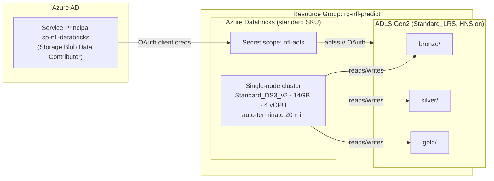

# Phase 1 — Cost-Optimized Architecture

## Target topology

## Why these choices (the senior/staff talking points)

| Decision | Rationale |
|---|---|
| **ADLS Gen2 (HNS) over plain Blob** | Hierarchical namespace → true directories, atomic rename, POSIX ACLs. Required for Delta performance at scale. |
| **Service principal, not account keys** | Scoped (one storage account), rotatable, auditable. Account keys = god-mode, un-rotatable in practice. |
| **Direct `abfss://` + OAuth, not `dbutils.fs.mount`** | Mounts are legacy/global and discouraged under Unity Catalog. Per-session OAuth keeps creds in the secret scope. |
| **Single-node cluster** | 10 yrs of PBP ≈ a few GB — fits in 14 GB RAM. A driver-only node removes worker DBU + VM cost (the biggest lever). |
| **Auto-terminate 20 min** | The #1 cost killer for students is an idle cluster. 20 min balances dev iteration vs. burn. |
| **standard SKU + LRS Hot** | Cheapest viable. Premium adds KV-backed scopes/RBAC you don't need yet; LRS is fine for a reproducible lake. |

## Cost model (keep it under $5/mo)

| Component | Rate (East US, approx) | Assumption | Monthly |
|---|---|---|---|
| Databricks compute (DBU + DS3_v2 VM) | ~$0.85–0.90 / hr all-in | ~4–5 cluster-hours/mo | **~$3.5–4.5** |
| ADLS Gen2 storage | ~$0.018 / GB / mo (Hot LRS) | ~3–5 GB | **< $0.10** |
| ADLS transactions | ~$0.005 / 10k ops | light dev | **< $0.10** |
| **Total** | | | **≈ $4 / mo** |

> **The lever that matters:** cluster hours. 5 hrs/mo ≈ $4. 20 hrs/mo ≈ $17 and blows the budget.
> Always let auto-terminate fire; never leave a cluster running overnight.

### Guardrails to set in the Portal
1. **Cost Management → Budgets**: create a $5 budget with alerts at 50/80/100%.
2. Confirm **auto-terminate = 20 min** on the cluster (don't trust defaults).
3. Filter Cost Analysis by tag `project = nfl-prediction-platform` to watch this project only.

## Quota caveat (read before `terraform apply`)
Azure for Students often ships with a **low regional vCPU quota** (sometimes 4–6 total for a VM family).
A single `Standard_DS3_v2` driver needs **4 vCPUs** of the `Standard DSv2 Family`. If `terraform apply`
or cluster start fails with a quota error:
- Check: `az vm list-usage -l eastus -o table | grep -i dsv2`
- Request an increase (Portal → *Quotas*), or switch region (eastus2 / westus2 often have headroom).
